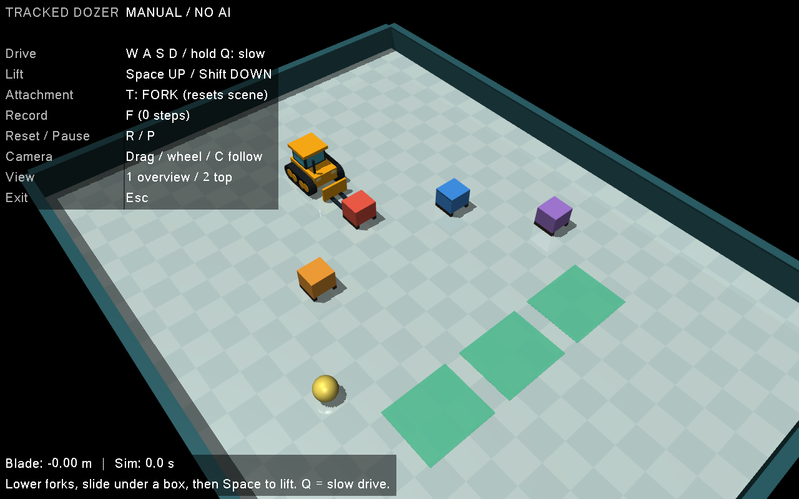

# Physical AI Course Builder — ブルドーザーが坂を運んで峠を組み、渡る（MuJoCo 3.3.7）

**English summary.** A MuJoCo 3.3.7 sandbox: a rule-controlled, skid-steer bulldozer with a fork lifts, carries and places free-body course parts, then drives the course it has just built.
Two slope modules (1.5 m incline + 0.5 m landing, 0.44 m top) form a 16.3-degree pass with a 1 cm nominal joint; each run ends in a pass/fail check on placement, wheel contact and undisturbed parts.
All motion goes through actuators: no teleport, no weld, no external force. LLM-written plans are validated as JSON before physics; no API call, no inference at replay. Times are simulation seconds.
This repository is the bulldozer half of the author's Physical AI course final project; the three-robot film, manager AI and mood net live in mujoco_3body (link below), which imports this code as is.
Verified on Windows, Python 3.12; the construction also runs on MuJoCo 3.11.0 / Python 3.10 in mujoco_3body. Only `third_party/rsplan` (MIT) is third-party; the rest was written here with LLM help.

Terms: BZ = the bulldozer of this repository (rule control, no learned model). Slope module = a free 2 m x 1 m part with a 0.44 m top, 1.5 kg, lifted by the fork.
Microduck (Pollen Robotics) and Jumper (KingKong Robotics) = the two walking robots in mujoco_3body that cross the pass BZ builds; they are not part of this repository.
Manager AI and mood net = the two trained models in mujoco_3body; this repository provides only the construction and driving they rely on.
Course-builder = the short name mujoco_3body uses for this repository (`v6_common.course_builder()`).

本リポジトリは、履帯外観のブルドーザー型車両（フォーク付き）が、床に固定していない坂パーツを持ち上げて運び、所定の位置に置いてつなぎ、組み上がった峠を自分で渡るまでを 1 つの MuJoCo シーンで実行する物理シミュレーションの実験場である。
制御は車両と部材の状態を観測するルール制御で、座標の書き換え・吸着固定・外力は使わない。
対話型 LLM が書いた計画 JSON を検査して施工し結果 JSON を返す往復、公開の経路生成器 rsplan を使った空荷の走行試験、人のお手本を集めて小さな行動クローニングを試す道具も含む。



## 最終課題との関係

- 本リポジトリは、提出動画に登場するブルドーザー（BZ）の施工・走行を担う土台である。坂 2 枚を運んで峠を組み、自分で渡るまでがここで実装されている。
- 提出動画、3 体（ブルドーザー・パッカン（Microduck, Pollen Robotics）・跳跳（Jumper, KingKong Robotics））の連携、支配人 AI と気分ネットは別リポジトリ [mujoco_3body](https://github.com/ortiz-ai-partners/mujoco-3body) にある。
- 両リポジトリは同一作者（GitHub アカウント ortiz-ai-partners）が同じ最終課題のために作成した自作で、コードと文書の作成に LLM の支援を使った（「AI の使い方」節）。
- mujoco_3body は隣接ディレクトリに置いた本リポジトリをそのまま import する。提出動画と評価は本リポジトリの commit ea5b4e7（継ぎ目 1 cm）で作られた（mujoco_3body の `docs/reproduce.md`）。

## まず試す

1. Python 3.12 を用意し、`setup.cmd` を実行する。`.venv` を作り `requirements-lock.txt`（mujoco 3.3.7、glfw 2.10.2、numpy 2.5.3、pillow 12.3.0）を導入する。初回だけ通信する。
2. `build-slopes.cmd`（`python app.py --build-slopes`）を実行する。上り坂を設置 → 空荷で下り坂の置き場へ → 下り坂を設置 → スタート側へ戻る → 完成した峠を渡る、を 1 つのシーンで続ける。P で一時停止、Esc で終了。
3. 画面左上に `BUILD TWO SLOPES / RULE CONTROL … nominal joint gap: 0.01 m`、終了時に `COMPLETE | Placed 2 slopes; crossed 4/4 surfaces; rise 0.440 m` と出れば成功である（`app.py` の表示文、`slope_assembly.py` の停止理由）。

期待される数値（シミュレーション時間、実時間は PC 性能による）：所要 約 200 s、4 面すべてに車輪が接触、車体上昇 0.440 m、設置誤差 1.3〜1.6 cm（継ぎ目 5 cm 時の値）。
継ぎ目 5 cm 時の実測は 202.06 s、設置誤差 1.62／1.35 cm（`examples/fast-construction-results.json`、target 1.5・fast_empty true）。
継ぎ目 1 cm での再施工は 199.32 s、4/4 面、上昇 0.440 m（mujoco_3body の `python v6_phase1_build.py`、`out/v6_phase1_report.json` の `seconds`、MuJoCo 3.11.0）。本リポジトリ側の結果 JSON は再生成していない。
描画なしで同じ工程を検査するには `python verify_slope_assembly.py` を使う（施工・走行の成功、設置済み部材に外力を加えたときの失敗停止、qpos の直接書き換えがないこと）。
このスクリプトの下り坂の誤差照合は旧目標 y=1.05 のままである（「結果」節の表 1 の注記）。

以下のコマンドはリポジトリルートで `.venv` を有効にして実行する（Windows は `.venv\Scripts\activate`）。検証環境は Windows・Python 3.12・MuJoCo 3.3.7 で、他の OS は未検証である。
mujoco_3body 側は MuJoCo 3.11.0・Python 3.10 で同じ施工を実行し、成功している（3 体同居の提出版で施工完了 sim 196.1 s、`out/v7_full_report_take51.json` の `events`）。
単独の再施工 199.32 s との差は主に CROSS 区間で生じる（提出版 19.70 s、単独 22.82 s）。TO_START 区間は 70.32 s と 70.44 s でほぼ同じである（提出版の `events`、`out/v6_phase1_report.json` の `timeline`）。
提出版は復路の経由点を差し替えており（「mujoco_3body からの利用」節）、CROSS の始点が 0.2 m 北（y=−3.0）になることが関係すると考える（未検証）。

## できること

### 上り坂・下り坂を運んで組み、渡る

`build-slopes.cmd`（`python app.py --build-slopes`）。資材は x=−1.5 m の置き場に、車両は (−3, −0.75) から開始し、目標は x=1.5 m、上りが y=−1 m、下りが y=1.01 m（`slope_assembly.py` の `assembly_xml` と `INSTALLATION_GAP`）。
工程は UP → RAISE_UP → TO_DOWN → PRECISE_LANE → ALIGN → RETREAT_FOR_ALIGNMENT → LOWER → DOWN → RAISE_DOWN → TO_START → CROSS（`slope_assembly.py` の phase）。
成功条件は車体上昇 0.42 m 超かつ 4 つの坂面（上り・下り × 斜面・平面）すべてに車輪が接触すること。設置済みの部材が 4 cm を超えて動いたら失敗停止、25,000 制御ステップで打ち切る。

各パーツを約 0.21 m 持ち上げて約 2.98 m 運ぶ（DEVELOPMENT.md の記録。mujoco_3body の `out/v7_full_report_take51.json` の `construction.parts[].lift_m`／`carry_m` でも 0.208 m・2.98 m）。
設置誤差は 1.3〜1.6 cm（継ぎ目 5 cm 時、`examples/fast-construction-results.json` の target 1.5 の `errors`）。
2 枚の天面のあいだの公称の継ぎ目は 1 cm で、当初は 5 cm だった。変更の理由は「工夫点」節に書く。
2 枚目（下り坂）は持ち上げ前に車体の向きを合わせ、持ち上げ後に不要な横補正をしない（`transport.py` の `align_before_lift`。`slope_assembly.py` は下り坂の `Transport` にだけ `align_before_lift=True` を渡す）。
旋回による横ずれの補償値 `TURN_LATERAL_ESTIMATE`（0.164 m）はこの配置で調整した値である。

### 対話型 LLM が計画した「こもれびの小さな峠」

`ai-slope-course.cmd`（`python app.py --slope-plan examples/ortiz-slope-plan.json`）は、保存した計画 JSON を検査し、坂 2 個を運んで設置し、そのコースを走る。計画名はウィンドウタイトルに出る（`app.py`）。
計画 → 検査 → 物理施工・走行 → 結果 JSON → LLM による講評、を一巡させた。名前・理由・配置は `examples/ortiz-slope-plan.json`、結果は `examples/ortiz-slope-result.json`、結果を読んだ判断は `examples/ortiz-slope-review.json`。
ファイル名の ortiz は、計画役として使った対話型 LLM に与えたペルソナ名で、GitHub アカウント名と同じである。

```
python slope_plan.py --capabilities
python slope_plan.py examples/ortiz-slope-plan.json --report .test-results/slope-result.json
python app.py --slope-plan examples/ortiz-slope-plan.json
python verify_slope_plan.py
```

対応するのは x=1／1.5／2 m の 3 位置、上り y=−1 m・下り y=1.01 m、向き 0 度、上り → 下りの施工順、+Y 方向の走行である（`slope_plan.py` の `CAPABILITIES`）。LLM もこの限定テンプレートから選ぶ。
不正な計画 11 種（不明フィールド・逆順・逆走・接続ずれ・重なり・回転・非対応位置・真偽値座標・非数・重複・欠落）は物理を起動する前に拒否し、理由を結果 JSON に返す（`verify_slope_plan.py`）。
計画ファイルの SHA-256 を結果に残し、計画からコードやコマンドを実行する仕組みはない。計画と講評は対話型 LLM とのやりとりで行い、アプリから LLM を自動で呼ぶ機能はない。再生中に新しい推論や学習は行わない。

保存済みの結果と講評は継ぎ目 5 cm 時（下り y=1.05）のもので、x=1 m の初案は 166.36 s、設置誤差 1.88／1.46 cm、上昇 0.4401 m、4/4 面で成功し、3 位置の中で最短だったため採用を維持した（`examples/ortiz-slope-review.json`）。
継ぎ目を 1 cm にした現行コードでは y=1.05 の計画は検査で拒否されるため、`examples/ortiz-slope-plan.json` の下り y を 1.01 に更新した。結果 JSON の `plan_sha256` は旧計画のもので、再生成はしていない。
計画の `rationale` にある「公称 5 cm」の記述は LLM が書いた原文として残した。

### 一体型の坂を運んでコースをつくる

`move-ramp.cmd`（`python app.py --portable-ramp`）は、坂の下へフォークを差し込み、持ち上げ → 約 3 m 運搬 → 設置 → 回り込み → その坂を走行、を約 93 s で実行する（DEVELOPMENT.md の記録 92.74 s）。
坂は 3.6 m × 1 m、天面 0.44 m（旧規格 0.2／0.3／0.4 m も保持）、中央の下に 8 cm の差し込み空間、質量 3.0 kg の自由物体（`portable_ramp.py`）。天面 0.44 m は既存ブロック（脚 8 cm＋本体 36 cm）と共通で、斜面は 16.3 度になる（`parts.py`、`app.py` の表示文）。
`python verify_portable_ramp.py` で持ち上げ約 0.206 m、運搬約 2.98 m、設置誤差約 1.4 cm、車体上昇約 0.44 m、3 面への車輪接触、最後に坂と車両が静止することを検査する。

設計室（後述）の「この位置へ坂を運んで渡る」から、編集した x 位置（0.5〜2 m、y=0、天面 0.44 m）への施工を実行できる。箱 2 個は (4, ±3) の待機位置に置き、運ぶのは一体型の坂だけである（`portable_ramp.py` の `validate_ramp_build`）。
`python verify_ramp_build.py` は x=0.5／1.25／2 m を検証し、設置誤差約 1.4〜1.5 cm、施工と走行 67.56〜98.52 s だった（DEVELOPMENT.md の記録、再計算は同スクリプト）。

### 上り坂・下り坂を単体で置く、それぞれ運ぶ

単体の坂パーツは長さ 2 m（斜面 1.5 m＋平らな接続面 0.5 m）、幅 1 m、天面 0.44 m、質量 1.5 kg の自由物体で、床に固定しない。下側を開けて爪を受ける桟を重心付近に置いた（`slope_parts.py`）。
`python verify_slope_parts.py` は 2 個を接続した据え付け配置で車両が登降し、4 面への車輪接触・約 0.44 m の上昇・パーツ移動最大約 0.05 cm を確認する。これは据え付け済みの走行試験で、施工成果ではない。

`move-up-slope.cmd`／`move-down-slope.cmd`（`python app.py --move-slope up`／`down`）は単体坂を x=1.5 m へ約 3 m 運び、約 16 s で下ろして爪を抜く。偏った重心に合わせ、車両の進路をパーツ中心から左右 0.25 m ずらして爪を入れる。
`python verify_slope_transport.py` は上り／下り × 目標 x=0.5／1.5／2.5 m の 6 条件で、持ち上げ約 0.208 m、運搬 1.98〜3.98 m、設置誤差約 1.4 cm、14.4〜18.1 s を確認し、拾えなかった場合は失敗として停止する。

### 箱 2 個の門を施工してから走る

`build-and-drive.cmd`（`python app.py --plan examples/ortiz-gate-plan.json --assemble`）。赤い箱を設置 → 後退と旋回 → 青い箱を設置 → スタート側へ戻る → 完成した門を通過、を同じシーンで続ける。
資材は x=−1.5 m の 2 列に置き、各列の y は完成位置に合わせる。運搬中の旋回はせず、空荷で旋回して列を移る。対応範囲は箱 2 個の x が同じ 0.5〜3 m、赤の y が 0.75〜1.5 m、青の y が −1.5〜−0.75 m で、範囲外は実行前に拒否する（`assembly.py`）。
`python verify_assembly.py` は 2 種類の門で、操縦中に qpos が書き換わらないこと、時間が単調に進むこと、両箱の設置誤差（約 1.4〜2.7 cm）、施工後の走行を確認する。4 経由点の例は 174.12 s だった（DEVELOPMENT.md の記録）。
`examples/ortiz-gate-plan.json` は対話型 LLM が命名した「ふたつの灯台ゲート」の計画で、`python app.py --plan examples/ortiz-gate-plan.json` は完成形を初期配置として走行だけを行う（`ai_plan.py --report` で結果 JSON）。

### 据え付け済みの固定坂を渡る実験

`ramp-demo.cmd`（`python app.py --ramp`）は、高さ 0.35 m・幅 1.8 m、上り 2 m → 水平 1 m → 下り 2 m の静的な坂を、フォークを上げてから約 19 s で通過する（`terrain.py`）。坂の施工やエディターとは独立した物理実験である。
`python verify_terrain.py` は高さ 25／35／45 cm（傾斜約 7.1／9.9／12.7 度）で車体の上昇・3 面への車輪接触・終点停止・床への復帰を確認し、衝突判定を外した「見た目だけの坂」が成功判定されないことも検査する。

### 公開の経路生成器を使った空荷の運転教習コース

`course-lab.cmd` で 1=広いヘアピン、2=狭い切り返しを選ぶ。Space で開始／一時停止、R で最初へ、Esc で終了。緑の点は前進、オレンジは後退の予定経路である。`fast-course-lab.cmd` は同じコースのスポーツ走行（`rs_course.py --sport`）。
経路生成には [Built Robotics の rsplan](https://github.com/builtrobotics/rsplan) を commit 47b3ab57 で版固定し、MIT ライセンスと NOTICE を付けて `third_party/rsplan` に同梱した。
rsplan は幾何学的な Reeds-Shepp 経路生成器で、学習 AI ではない。追従制御は自作で、物理シーンの状態を見て操作する。

- 広いコース（旋回半径 2 m）：直線 → 前進で半円旋回 → 直線。狭いコース（半径 1.5 m）：直線 → 後退旋回 → 前進旋回 → 後退旋回 → 直線、前後の切替 4 回（`rs_course.py` の `SCENARIOS`）。
- 4 cm 間隔の参照姿勢でフォーク込みの車体外形（前 1.5 m／後 0.6 m／幅 ±0.52 m）＋10 cm の余裕を検査し、障害物や外壁に当たる候補は起動を拒否する（`rs_course.py` の `footprint`）。積載指定と他の可動物体があるシーンも拒否する。
- 実走中の接触・過大な傾き・経路逸脱・時間超過は失敗にする。成功基準はこの走行試験専用の最終 20 cm・10 度以内と停止で、姿勢課題の 8 cm 基準とは別である。前後切替は停止（0.03 m/s 未満）を確認してから行う。
- 車輪の速度上限 8 rad/s と力の上限 ±15 は変えていない（`scene_fork_tracks.xml` の velocity アクチュエータ）。速いのは主に直線部分で、スポーツ走行は曲線の前後進入力・旋回指令の上限・終点への減速を調整したものである。

```
python rs_course.py --case wide --report .test-results/course-wide-01.json
python rs_course.py --case narrow --sport --report .test-results/course-narrow-sport-01.json
python verify_rs_course.py
```

この試験は固定の 2 配置、空荷、平地だけで、区間境界で一旦停止する。別候補を探索する汎用の障害物回避は未実装である。数値は「結果」節の表 3 にまとめた。

### 最高速の単独試験

`speed-demo.cmd`（`python speed_demo.py --motor-limit`）は平地・空荷で XML のモーター上限 8 rad/s まで使う独立デモで、Space で開始／停止、R でリセット、10 s 走行後に制動する。通常の W キーは車輪指令 5 rad/s である（`speed_demo.py` の `wheel_command_rad_s`）。
上限を使う走行の実測は約 5.16 km/h（`examples/rs-course-results.json` の `peak_km_h` 5.157）、W キー全開は開発時の実測で約 3.23 km/h（再計測は `python speed_demo.py --measure`）。実機の仕様値ではない。

### 前進・後退の選択（空荷の位置目標）

`reverse-demo.cmd` は真後ろ 1 m の目標へバックで近づいて停止し、`forward-only-demo.cmd` は同じ条件を前進だけで走る（`python app.py --maneuver reverse-enabled`／`forward-only`）。
ルールは、目標方向の誤差が π/2＋0.2 rad（約 101.5 度）を超えたら後退を選び、その経由点に着くまで前後進を固定する（`navigation.py` の `allow_reverse`）。切替のちらつきを避けるためである。
`python verify_maneuver.py` は 5 条件を両方式で比較する（「結果」節の表 2）。停止誤差は約 13〜14 cm で、爪差し込みの精密位置合わせには足りない。障害物を予測して避ける機能はなく、後方に箱がある試験では接触を検出して失敗停止する。

### 施工中の空荷移動の高速化

`Navigator` の `fast_empty` は既定で無効で、`SlopeAssembly` が TO_DOWN／TO_START（坂を置いた後の空荷移動）でだけ有効にする。目標 x=1.0／1.5 m では自動で有効、2.0 m では無効で、`fast_empty` 引数で上書きできる。
加速の条件は、前進・目標まで 2 m 超・向き誤差 0.06 rad 未満・車体が水平で、車体基準の通路（前 3.1 m／後 0.8 m／左右 0.75 m）に衝突形状がないこと（`navigation.py` の `cruise_clear`）。箱は姿勢込みの投影外形、それ以外は包囲球で保守的に判定する。
空荷移動中に車体が何かに触れると「Empty transfer touched course geometry.」で失敗にする。参照する状態はシミュレータの値で、実機のセンサー推定ではない。比較は `python verify_fast_construction.py`、加速可否の検査は `python verify_cruise_gate.py`。

### 位置と向きを合わせる姿勢課題と、お手本の収集・再生・学習の準備

`pose-practice.cmd` で 1=後退、2=前進、3=左斜め後ろを選び、車体の中心を緑の丸へ、車体前方を緑の矢印へ合わせる。WASD で移動、Q を押しながらで低速、F で記録開始、R で最初の位置へ。
成功条件は位置 8 cm・向き 8 度以内で、並進 0.03 m/s 未満・角速度 0.04 rad/s 未満を 1 秒維持すること、制限 120 s（`pose_task.py`）。ケースは学習用 3（back／front／rear-left）と評価用 2（rear-right-eval／rotated-eval）。
記録は `recordings/pose/` に 50 Hz の操作前後の状態・目標・車体基準の目標位置と向き・速度・使用シーン・成功判定を保存する（画像や動画ではない）。収録データと学習済みモデルは Git の対象外である（`.gitignore`）。

- `check-demos.cmd`（`python pose_dataset.py --summary`）：ケース別の成功候補の本数、不足数、重複、要点検ファイルを表示する。記録は書き換えない。
- `replay-demo.cmd`（`pose_replay.py`）：保存した操作を物理エンジンに再入力し、記録された位置・速度との一致を毎ステップ検査する。状態の復元は開始時の 1 回だけで、同一の MuJoCo バージョンを要求する。
- `pose_prepare.py` → `pose_bc.py` → `pose_evaluate.py` → `pose_view.py`：実演単位で訓練・検証に分け、7 入力 → 32 中間（tanh）→ 前後進 5 択＋旋回 5 択の分類器を NumPy／CPU で学習し、同じ初期シーンと 8 cm／8 度／1 秒停止の基準で物理評価・表示する。
- `python pose_evaluate.py --output .test-results/pose-baselines.json` はモデルなしでルール 2 種（前進のみ・前後進）の基準値を作る。結果は `examples/pose-baselines.json`（「結果」節の表 4）。

```
python pose_prepare.py --output .test-results/pose-dataset-01.npz
python pose_bc.py .test-results/pose-dataset-01.npz --output .test-results/pose-model-01.npz
python pose_evaluate.py --model .test-results/pose-model-01.npz --output .test-results/pose-evaluation-01.json
python pose_view.py --rules reverse --case back
python verify_pose_task.py && python verify_pose_replay.py && python verify_pose_learning.py
```

人のお手本 5 本（後退 3・前進 2）で初回の学習を行った。先頭の停止フレームを除いたモデルは前後進するが、位置誤差は後退で 8.51 cm・前進で 22.06 cm で、8 cm の基準には届かなかった。
出所は DEVELOPMENT.md の記録（誤差）と、commit ea5b4e7 時点の README.md（本数の内訳）である。
記録とモデルは Git の対象外で同梱していないため、この数値は再計算できない。少数の固定開始条件での結果で、一般化や安定走行は確認していない。この結果の受け止めは「反省・考察」節に書く。

### 完成形をドラッグして設計する

`design.cmd`（`designer.py`）でローカルのブラウザに「遊びの設計室」（`editor.html`）が開く。ローカルサーバーは 127.0.0.1 だけで待ち受け、外部 API は使わない。`editor.html` を直接開くと保存先が起動しないので、必ず起動用の CMD から開く。
赤・青の箱 2 個、一体型の運搬坂 1 個、上り坂・下り坂各 1 個を 25 cm グリッドで配置し、単体坂だけ 90 度ずつ回転できる。重なりと範囲外は保存時にも検査し、「ひとつ戻す」で取り消せる。保存先は `designs/layout_日時.json` と `designs/latest.json`（Git の対象外）。
「保存して 3D で見る」は箱を指定位置に置いた静止プレビューで、ロボットが運んだ施工結果ではない。「赤い箱を自動で運ぶ」は赤い箱 1 個の直線運搬で、成功は目標誤差 6 cm 未満・箱が床で静止・フォークが離れたこと。
`python verify_transport.py` は 4 目標（(−1, −3)、(0, 0)、(1.5, 0.75)、(4, 3)）で持ち上げ・運搬・設置誤差・静止を確認する。配置の検証は `python verify_layout.py`、手動での 3D 表示は `python app.py --layout designs/latest.json`。
差し込みは低速のまま、運搬中の速度上限を上げて加減速を段階化し、約 3 m の運搬は 26.18 s から 17.72 s に短くなった（開発時の記録、再計算は `python verify_transport.py`）。

### 手動運転

`start.cmd`（`python app.py`）で 3D 画面が開く。クリックしてから操作する。日本語入力が干渉する場合は英数入力に切り替える。

| キー | 操作 |
| --- | --- |
| W / S | 前進 / 後退 |
| A / D | 車体基準の左旋回 / 右旋回 |
| Space / Shift | フォーク・ブレードを上げる / 下げる |
| Q＋移動キー | 速度 30% で位置合わせ |
| T | 装備交換（ブレード／フォーク）。場面をリセットし、記録中なら保存終了 |
| F | 記録開始 / 保存終了 |
| R | 場面をリセット。記録中なら保存終了 |
| P | 一時停止 / 再開 |
| C | 追従カメラ切替 |
| 1 / 2 | 全体の斜め視点 / 真上 |
| 左 / 右ドラッグ、ホイール | カメラ回転 / 移動、拡大・縮小 |
| Esc | 終了。記録中なら保存 |

最初は正面の赤い箱で試す。Shift で爪を下げ、Q＋W で箱の脚の間に差し込み、W を離して Space で上げる。ゆっくり運び、Shift で床に下ろしてから S で爪を抜く。急な旋回や浅い差し込みでは荷が落ちる。
キーを離すと駆動の目標速度はゼロになるが、慣性で停止まで時間がかかる。緑の領域は目印で、手動運転に自動の成功判定はない。

## mujoco_3body からの利用

mujoco_3body は本リポジトリのコードを改変せずに読み込み、ブルドーザーの施工・走行をそのまま使う。使用した版は commit ea5b4e7（継ぎ目 1 cm）である。

- `v6_common.course_builder()` が本リポジトリのパスを `sys.path` に加え、`app`（`Simulation`、`ROOT`）、`slope_assembly`（`assembly_xml`、`SlopeAssembly`）、`tracks` を import する。
- 土台のシーンは `slope_assembly.assembly_xml(app.ROOT / "scene_fork_tracks.xml")` で、車両・待機位置の箱 2 個・置き場の坂 2 枚を含む。mujoco_3body 側はこの XML に 2 体のロボットを MjSpec で結合する（`v6_robots.py` の `spec.attach`）。
- 施工は `SlopeAssembly(sim)`（既定の目標 x=1.5 m）を 1 ステップずつ `action(sim)` で進める。提出動画では施工完了が sim 196.1 s、4/4 面、上昇 0.440 m（`out/v7_full_report_take51.json` の `events` と `construction`、MuJoCo 3.11.0）。
- 施工以外のブルドーザーの移動には `Navigator(sim, waypoints, allow_reverse=True)` を使う（`v7_full.py` の `make_navigator`）。
- mujoco_3body の支配人 AI の学習環境は、コース破損の判定に本リポジトリと同じ「部材が 4 cm を超えて動いたら」を使う（`manager2_env.py` の `COURSE_TOLERANCE`）。

復路の罠（本リポジトリ側の反省点）：`SlopeAssembly` の TO_START の経路は角 (−1, −3.2) で南を向く（経由点の到達判定は 14 cm 以内、`navigation.py`）。
フォークを上げた爪先は車体の 1.38 m 前まで届き、シーンの南壁の内面 y=−4.5 との余裕は約 8 cm しかない。南壁は `scene_fork_tracks.xml` の中心 y=−4.6・半厚 0.1 m の箱である。
爪先の到達距離と余裕は mujoco_3body 側の計測である（`v7_full.py` の注記、`docs/physics_integration.md` の 7-1 節）。

単体では通るが、3 体が同じワールドにいるとソルバーの数値差で軌跡が十数 cm ずれ、`fork_right` が壁に触れて `fast_empty` の接触検査が施工を中断した。
mujoco_3body 側は TO_START に入った瞬間に同じ設定の `Navigator` を角 y=−3.0 で差し替えて回避している（`v7_full.py`、提出版の `events` に `TO_START route: corner at y=-3.0` が残る）。
本リポジトリの既定経路は変えていない。経路の角は「車体の到達範囲＋余裕」で決めるべきで、固定の数値で壁際を通す設計は脆いという教訓である。

## 結果

数値はすべてシミュレーション時間で、再生倍速ではない。各表の下に出所と再検証コマンドを示す。表 1 と「こもれびの小さな峠」の結果は継ぎ目 5 cm 時の記録である。

### 表 1：坂 2 枚の施工 3 配置 × 空荷の高速移動あり／なし

| 目標 x (m) | 高速移動 | 所要 (s) | 空荷最高速 (km/h) | 設置誤差 上り／下り (cm) | 結果 |
| --- | --- | --- | --- | --- | --- |
| 1.0 | なし | 166.36 | 2.19 | 1.88 / 1.46 | 4/4 面、上昇 0.440 m |
| 1.0 | あり | 165.16 | 4.34 | 1.65 / 1.40 | 4/4 面、上昇 0.440 m |
| 1.5 | なし | 203.00 | 2.13 | 1.63 / 1.31 | 4/4 面、上昇 0.440 m |
| 1.5 | あり | 202.06 | 4.40 | 1.62 / 1.35 | 4/4 面、上昇 0.440 m |
| 2.0 | なし | 200.22 | 2.15 | 1.75 / 1.31 | 4/4 面、上昇 0.440 m |
| 2.0 | あり | 207.68 | 4.45 | 1.61 / 1.28 | 4/4 面、上昇 0.440 m |

出所：`examples/fast-construction-results.json`（`seconds`、`empty_peak_kmh`、`errors`）。再検証：`python verify_fast_construction.py`。
高速移動は短い区間だけに効くため全体では約 1 s の短縮にとどまり、x=2.0 m では 7.46 s 遅くなった（理由は「反省・考察」節）。

注記：`verify_fast_construction.py` と `verify_slope_assembly.py` は下り坂の誤差を旧目標 y=1.05 に対して計算し、6 cm 未満を合格とする（両スクリプトの `errors` と `< .06` の検査）。
継ぎ目 1 cm の再施工（mujoco_3body、MuJoCo 3.11.0）では、旧目標に対する下り坂の誤差は 4.39 cm で閾値に収まった（`out/v6_phase1_report.json` の `placement_errors_m.down_1`）。
同じ設置姿勢（同 JSON の `poses.down_1.pos`）を現行目標 y=1.01 と比べると約 1.5 cm である。本リポジトリの MuJoCo 3.3.7 での再実行はしていない。
`verify_slope_assembly.py` が報告する `nominal_gap_m` 0.05 も旧値のままで、未修正の既知の不整合である。

### 表 2：空荷の位置目標、前進のみ／後退可の比較

| 目標（車体基準） | 前進のみ (s) | 後退可 (s) | 移動距離 前進のみ → 後退可 (m) | 累積旋回 前進のみ → 後退可 (度) |
| --- | --- | --- | --- | --- |
| 前方 1 m | 3.82 | 3.82 | 0.86 → 0.86 | 0 → 0 |
| 真後ろ 1 m | 34.84 | 3.72 | 2.37 → 0.86 | 280.7 → 0 |
| 左斜め後ろ (−1, 0.5) | 31.58 | 5.50 | 2.41 → 1.00 | 248.7 → 31.6 |
| 右斜め後ろ (−1, −0.5) | 31.58 | 5.50 | 2.41 → 1.00 | 248.7 → 31.6 |
| 初期向き 90 度・後方 1 m | 34.84 | 3.72 | 2.37 → 0.86 | 280.7 → 0 |

出所：`examples/maneuver-result.json`（`paired_trials` の `seconds`、`distance_m`、`turn_degrees`）。停止誤差は全条件 0.134〜0.139 m。
後方に箱を置いた負例は 1.28 s で接触を検出して失敗停止した（`blocked_rear`）。再検証：`python verify_maneuver.py`。

### 表 3：rsplan の 2 コース × 3 プロファイル

| コース | プロファイル | 所要 (s) | 最高速 直線／曲線 (km/h) | 終点誤差 | 前後切替 |
| --- | --- | --- | --- | --- | --- |
| 広いヘアピン | 通常 | 62.78 | 3.27 / 0.82 | 0.119 m、0.9 度 | 0 回 |
| 広いヘアピン | 高速直線 | 59.48 | 5.16 / 0.83 | 0.115 m、1.9 度 | 0 回 |
| 広いヘアピン | スポーツ | 28.36 | 5.16 / 2.38 | 0.112 m、2.0 度 | 0 回 |
| 狭い切り返し | 通常 | 49.92 | 3.32 / 1.16 | 0.116 m、1.9 度 | 4 回 |
| 狭い切り返し | 高速直線 | 49.18 | 5.16 / 1.07 | 0.108 m、1.7 度 | 4 回 |
| 狭い切り返し | スポーツ | 29.66 | 5.16 / 2.55 | 0.117 m、1.9 度 | 4 回 |

出所：`examples/rs-course-results.json`（`seconds`、`peak_km_h`、`curve_peak_km_h`、`reason`、`direction_changes`）。切替時の速度はすべて 4e-13 m/s 未満（`switch_speeds_m_s`）で、停止してから切り替えている。
スポーツ走行は高速直線プロファイルの 2.10 倍（広い、59.48 → 28.36 s）／1.66 倍（狭い、49.18 → 29.66 s）の速さで、同じ車両・コース・物理刻み・成功判定で比較した。再検証：`python verify_rs_course.py`。

### 表 4：姿勢課題（位置 8 cm・向き 8 度・1 秒停止）のルール制御の基準値

| ケース | 前進のみ | 前後進 |
| --- | --- | --- |
| back（真後ろ 1 m） | 未達（120 s） | 成功 5.66 s、位置誤差 3.93 cm |
| front（前方 1 m） | 成功 5.66 s | 成功 5.66 s |
| rear-left（左斜め後ろ） | 未達（120 s） | 未達（120 s） |
| rear-right-eval（右斜め後ろ） | 未達（120 s） | 未達（120 s） |
| rotated-eval（初期 90 度） | 未達（120 s） | 成功 5.66 s |

出所：`examples/pose-baselines.json`（`trials` の `success`、`seconds`、`final_metrics`）。前進のみは 5 条件中 1 成功、前後進は 3 成功。
斜め後ろの 2 条件は両方式とも 120 s で未達で、この単純なルールの限界を示す。再検証：`python pose_evaluate.py --output …`。

## 工夫点

- **継ぎ目を施工精度で詰めた。** 公称 5 cm の継ぎ目は、施工後に幅全体で 4.0〜4.5 cm の溝になり、mujoco_3body で歩くパッカンの足が渡る回数の約半分で溝に落ちた（環境の不備）。
  設置の y 誤差は数 mm にとどまる（旧コースの施工で上り y −1.00・下り y 1.05、`slope_assembly.py` の注記）。そこで公称を 1 cm にしても天面は重ならないと判断し、溝を閉じる設計に変えた。
  1 cm での再施工は 4/4 面・上昇 0.440 m・199.3 s、設置位置は上り y −0.999・下り y 1.009、継ぎ目の実測は 0.25〜1.25 cm（下り坂が 0.6 度傾いて置かれたため幅方向で変わる）。
  パッカンの継ぎ目通過は 8/8 でつまずき 0 だった（以前は約半数でつまずいた。commit ea5b4e7 のメッセージ、`slope_assembly.py` の `INSTALLATION_GAP`）。
- **持ち上げる前に向きを合わせる。** 2 個目のパーツを差し込むときにヨー角が残り、積載後の横補正で荷が回って継ぎ目に乗り上げた。
  爪を差した後に向きを合わせ、30 ステップの安定を待ってから持ち上げ、その位置を搬送レーンにして余計な横補正を抑えた（`transport.py` の `align_before_lift`、DEVELOPMENT.md の記録）。
- **外から渡される計画は物理の前で検査する。** 計画 JSON は厳密なキー集合・有限数・テンプレート一致を検査し、11 種の不正案を拒否して理由を返す。計画の SHA-256 を結果に残し、計画からコードを実行する経路を持たない（`slope_plan.py`）。
- **借りたコードは版と中身を固定する。** rsplan は commit を固定し、同梱した 5 ファイルの Git blob SHA-1 を `third_party/rsplan/NOTICE.md` に記録して照合した。改変はしていない。
- **速く走る条件を保守的に限定する。** 空荷の高速移動は、水平・直進・向き一致・通路に何もない、の全部が揃ったときだけ許し、触れたら失敗にする（`navigation.py` の `cruise_clear`）。運搬中には適用しない。
- **部材の規格を共通化した。** 天面 0.44 m を箱・一体坂・単体坂で揃え、組み合わせを増やした（`parts.py` の `STANDARD_TOP_HEIGHT`）。単体坂は下側を開けて桟を置き、フォークで拾える形にした。
- **失敗を自分で検出して止まる。** 設置済み部材の移動（4 cm）、箱との接触、箱の移動（1.5 cm）、過大な傾き、レーン逸脱（12 cm）、時間超過を各制御器が検査し、成功と表示するのは条件を満たしたときだけである（`slope_assembly.py`、`navigation.py`、`transport.py`）。

## 反省・考察

- **横ずれの補償値が配置専用である。** 空荷旋回後の横ずれを `TURN_LATERAL_ESTIMATE`（0.164 m）で補償しているが、これはこの置き場・目標・車両に合わせた調整値で、スキッドステアの運動モデルではない。
  配置を変えると再調整が要る。汎用化には、旋回後に実際の位置を測って補正する制御か、学習による補償が必要である。
- **高速化が x=2.0 m で逆効果だった。** 空荷の直線で約 2 倍の速度を出しても施工全体では約 1 s の短縮にとどまり、x=2.0 m では 207.68 s と 7.46 s 遅くなった（表 1）。
  高速区間の後の停止位置と向き合わせに時間を使うためで、経路制御の設計不足である。既定では 2.0 m で無効にした。
- **継ぎ目の余裕は薄い。** 設置誤差（xy ノルム）は 1.3〜1.9 cm だが（表 1）、継ぎ目に効く y 誤差が数 mm に収まっていたから 1 cm の公称で成立した。
  2 枚の y 誤差が互いに近づく向きに合計 1 cm を超えると天面が重なるため、この設計は差し込み時の向き合わせの精度に依存している。
- **壁際を通す固定経路は脆い。** 復路の角 (−1, −3.2) は爪先と南壁の余裕が 8 cm で、他のロボットがいるだけの数値差で接触した（「mujoco_3body からの利用」節）。
  経路の角は到達範囲と余裕から決めるべきで、利用側での差し替えで済ませた点は本リポジトリの未修正事項である。
- **模倣学習は基準に届かなかった。** お手本 5 本から学んだ分類器は前後進はするが、位置誤差が後退 8.51 cm・前進 22.06 cm で基準の 8 cm に届かなかった。
  データ 5 本・固定開始条件・操作の分類という設計では、目標で止まる操作を学ぶには不足だったと考える（設計の不足）。
  ここで下位操作の学習を広げるより、「失敗したときに次の一手を選ぶ」判断を学習の対象にする方が課題の核心に近いと判断し、学習の軸足を mujoco_3body の支配人 AI に移した。本リポジトリはルール制御の土台として残した。
- **ルール制御の限界が斜め後ろに出る。** 位置と向きを同時に合わせる課題では、斜め後ろの 2 条件が 120 s で未達だった（表 4）。
  前後進ルールの最終状態は位置誤差約 16 cm・向き誤差約 22 度で、止まらずに動き続けていた（`examples/pose-baselines.json` の `final_metrics`）。
  位置に着いた後に向きを直す動きで位置が崩れるためと考える。位置と向きを同時に扱う計画が要る（設計の不足）。
- **実機への一般化は確かめていない。** 履帯は外観で、接地は四輪近似である。rsplan は車型の経路を前提にするが、本車両はスキッドステアで旋回の仕方が異なる。部材の質量（1.5 kg、3.0 kg）と寸法は試作の仮値で、実物の強度や変形は再現していない。
- **計画の往復は手作業である。** LLM の計画と講評はチャットで行い、アプリから LLM を呼ぶ自動化はしていない。テンプレートは x の 3 択に限られ、任意の形や順番は扱えない。
- **検証スクリプトの定数が追従していない。** 継ぎ目の変更後も `verify_fast_construction.py` と `verify_slope_assembly.py` は下り坂の目標 y=1.05 を直書きしている（表 1 の注記）。目標は `INSTALLATION_GAP` から導くべきだった。

## AI の使い方

本リポジトリの実行時に動くものと、開発に使ったものを分けて書く。

| 区分 | 内容 | 既製／自作 | 実行時 | 学習 |
| --- | --- | --- | --- | --- |
| ルール制御 | `Transport`／`Navigator`／`SlopeAssembly` ほか | 自作 | 毎ステップ実行、AI 推論なし | なし |
| 計画 JSON | 「こもれびの小さな峠」「ふたつの灯台ゲート」 | 対話型 LLM が開発時に生成、JSON で保存 | 検査して再生、推論なし。アプリから LLM を呼ぶ機能なし | なし |
| 行動クローニング | `pose_bc.py`（7 → 32 → 5＋5、NumPy） | 自作 | 評価時だけ推論。モデルは非同梱 | 人のお手本 5 本で学習、基準未達 |
| 経路生成器 rsplan | `third_party/rsplan` | 既製（Built Robotics、MIT） | 走行試験の幾何計画 | なし（学習 AI ではない） |
| 提出動画の AI | 支配人 AI・気分ネット、公式 ONNX ポリシー 5 本 | 前 2 つは自作、ポリシーは既製 | mujoco_3body 側で推論。本リポジトリには含まれない | 支配人 AI（PPO・Q 表）と気分ネットを学習 |

本リポジトリ単体では学習済みモデルを同梱しない。提出動画で本番の推論を行う AI は mujoco_3body にある。
自作の 2 つは支配人 AI（固定ルール／表形式 Q／PPO）と気分ネットで、既製の 5 本はパッカンの velstand・alpha_sitstand、跳跳の locomotion・jump・dance_crab である（推論のみ）。
コードと文書の作成には対話型 LLM の支援を使った。初期開発の計画役は Codex の対話型セッションで、モデル ID は未確認である（`examples/ortiz-gate-plan.json` の `provenance.model_id` が `not verified`、`examples/ortiz-slope-plan.json` の `provenance.note`）。
DEVELOPMENT.md は同じ対話型セッションの作業報告を、施設の仕様などを除いて原文のまま収めたものである。継ぎ目の変更（commit ea5b4e7）と本 README の書き直しは Claude の支援で行った。設計判断と検証の責任は作者にある。

## 物理モデルの範囲

MuJoCo が接触・重力・摩擦を計算し、車輪を速度アクチュエータで駆動する。箱や坂を動かすときに座標を書き換えたり、フォークに吸着・固定したりしない。検証スクリプトは制御器が qpos を書き換えないこと、等式拘束が 0 であることを確認する。
車体はシャシー 0.86 × 0.54 × 0.26 m・質量 15 kg、半径 0.18 m の四輪で接地し、フォークの爪は長さ 0.68 m。履帯は片側 38 枚（両側 76 枚）の装飾ジオメトリで接触しない（`scene_fork_tracks.xml`、`tracks.py` の `COUNT`）。
アリーナは床 12 × 9 m、壁は中心 y=±4.6 m・x=±6.1 m の厚さ 0.2 m の箱（内面は y=±4.5 m、x=±6.0 m）。
履帯の連結・張力・たわみ・面接触・段差走破性は再現していない。昇降は鉛直スライド関節で、油圧やリンク機構、土砂の掘削は再現していない。フォーク用の箱は約 8 cm の脚付きである。

## 記録

手動運転の記録は `recordings/demo_日時.jsonl`、姿勢課題の記録は `recordings/pose/` に保存する。収録データは Git の追跡対象から除外している。

- ヘッダー：形式、MuJoCo バージョン、周期、使用シーンの SHA-256、装備、走行モデル、初期状態。
- 各ステップ：操作前状態、正規化された操作、アクチュエータ指令、操作後状態。状態は時刻、位置・関節姿勢、速度、昇降目標、主要物体の位置・姿勢。
- 終了行：ステップ数と終了理由。終了行がない記録は未完了として扱う。

対応範囲外：成功ラベル付きの画像・動画の収録、LeRobot 形式への変換。姿勢課題の記録だけが目標と成功判定を持つ。

## 検証

```
python verify.py
python app.py --screenshot check.png
```

`verify.py` は描画なしで前後進、左右旋回、昇降、押し移動、停止、記録、フォークによる持ち上げ・運搬・床への解放を確認する。箱の持ち上げと運搬はそれぞれ 0.4 m 超を閾値に検査する（この配置での実測は約 0.454 m と約 0.526 m）。
これは指定の初期配置での値で、全配置の成功率ではない。検査用の記録は `.test-results/` に保存する。

検証スクリプトは 21 本で、すべて描画なしで動く。

| 対象 | スクリプト |
| --- | --- |
| 基本動作・記録 | verify.py、verify_layout.py、verify_pose_ui.py |
| 運搬・施工 | verify_transport.py、verify_assembly.py、verify_navigation.py、verify_portable_ramp.py、verify_ramp_build.py |
| 坂パーツ・峠 | verify_slope_parts.py、verify_slope_transport.py、verify_slope_assembly.py、verify_slope_plan.py、verify_fast_construction.py、verify_cruise_gate.py、verify_terrain.py |
| 走行試験 | verify_rs_course.py、verify_maneuver.py |
| 姿勢課題・学習 | verify_pose_task.py、verify_pose_replay.py、verify_pose_learning.py、verify_pose_view.py |

検証は使い捨ての模擬記録と数値データで行い、人のロボット操作を学習した成果とは扱わない。学習の検査（`verify_pose_learning.py`）は玩具データで勾配・損失の減少・保存再読込を見る。

## ファイル

| 区分 | ファイル |
| --- | --- |
| 起点・共通 | app.py（手動操作、物理制御、描画、記録、各モードの起点）、tracks.py（履帯外観の付加）、parts.py（共通天面高）、layout.py（配置データ）、designer.py・editor.html（設計室） |
| シーン | scene.xml・scene_fork.xml（四輪版の元シーン）、scene_tracks.xml・scene_fork_tracks.xml（履帯外観付き。元シーンを変えたら `python tracks.py` で再生成） |
| 運搬・施工 | transport.py（1 個の運搬）、navigation.py（経由点追従、後退選択、空荷高速）、assembly.py（箱 2 個の門）、slope_parts.py・slope_transport.py・slope_assembly.py（単体坂と峠）、portable_ramp.py（一体坂）、terrain.py（固定坂） |
| 計画の受け渡し | slope_plan.py（坂計画の検査・実行・結果 JSON）、ai_plan.py（門計画の走行・施工）、examples/ortiz-slope-plan.json・ortiz-gate-plan.json・gate.json |
| 走行試験 | rs_course.py（rsplan 経路の追従）、speed_demo.py（最高速）、maneuver.py（前後進比較のシーン）、third_party/rsplan（版固定の経路生成器） |
| 姿勢課題・学習 | pose_task.py、pose_dataset.py、pose_prepare.py、pose_bc.py、pose_evaluate.py、pose_replay.py、pose_view.py |
| 結果の記録 | examples/fast-construction-results.json、maneuver-result.json、rs-course-results.json、pose-baselines.json、ortiz-slope-result.json、ortiz-slope-review.json |
| 検証 | verify*.py 21 本（「検証」節） |
| 起動（Windows） | setup.cmd、start.cmd と機能別の 17 本（各節に `名前.cmd` として記載。節に出ない drive-plan.cmd は `python app.py --plan examples/ortiz-gate-plan.json` の走行のみ） |
| その他 | requirements.txt（直接依存）、requirements-lock.txt（動作確認した全依存）、LICENSE、tracks-preview.png、DEVELOPMENT.md（開発記録） |

## 使用技術・制作・ライセンス

- 本リポジトリは MIT License（`LICENSE`、Copyright (c) 2026 ortiz-ai-partners）。
- `third_party/rsplan` は Built Robotics の rsplan（MIT、Copyright (c) 2023）を commit 47b3ab572a4b7ffc314dfc2aa68b8349f061fe13 で版固定し、無改変で同梱した。各ファイルの blob SHA-1 と範囲は `third_party/rsplan/NOTICE.md` にある。
- `third_party/` 以外の実装・シーン・文書は本プロジェクトのために作成した。コード作成には対話型 LLM の支援を使った（「AI の使い方」節）。
- 依存パッケージ（[MuJoCo](https://mujoco.readthedocs.io/en/stable/python.html)、[GLFW](https://www.glfw.org/)、NumPy、Pillow）は同梱せず、各配布元から `pip` で導入する。それぞれのライセンスに従う。
- 氏名・所属・個人の連絡先は本リポジトリの文書に含めない。

開発の経緯（作業時点の報告、新しい順）は `DEVELOPMENT.md` にある。
